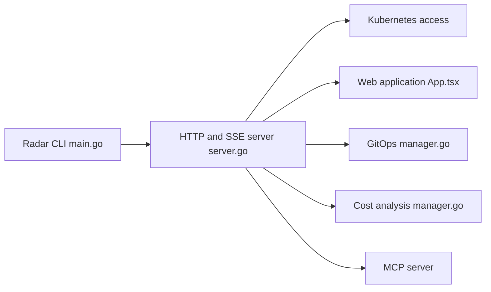

# skyhook-io/radar

> Open source Kubernetes interface as a single binary, local or in-cluster, with an MCP server for agents.

## The problem
Inspecting a cluster (topology, Helm, GitOps, costs, RBAC) takes several tools and a lot of `kubectl`.

## What it actually does
A binary that reads the Kubernetes API with your credentials and serves a real-time web UI (SSE). Views: topology, resources, Helm, comparison, TLS, GitOps (Argo CD, Flux), traffic (Hubble, Istio, Beyla…), OpenCost costs, a 31-check audit, upgrade impact, RBAC. MCP server enabled by default, can be disabled with `--no-mcp`.

## How it is wired


## Trying it
```bash
curl -fsSL https://get.radarhq.io | sh && kubectl radar
brew install skyhook-io/tap/radar
kubectl krew install radar
helm install radar skyhook/radar -n radar --create-namespace
```

## Cost and gotchas
Free locally. No authentication by default: in a cluster, enable a proxy or OIDC. Anonymous usage report disabled unless you opt in. MCP write actions go through Kubernetes RBAC.

## What it is not
Not a persistent monitoring tool: the timeline is in memory by default. The hosted multi-cluster offering (Radar Cloud) is paid and separate.

## Alternatives
No alternative named in the README (Polaris, Kubescape, Trivy are cited as inspirations for the audit).

## For you
Worth watching if you operate clusters (MLOps): good discovery-to-effort ratio, but out of scope if you do not use Kubernetes.
