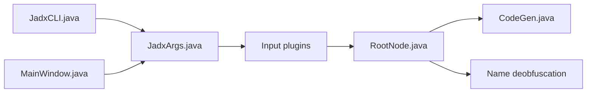

# skylot/jadx

> A Dex-to-Java decompiler, as a command line and a graphical interface, for APKs and Android bytecode.

## The problem
Auditing or understanding an Android application without its sources means reading Dalvik bytecode or smali.

## What it actually does
Decompiles APK, dex, aab, jar, class, aar and smali into Java code. Decodes `AndroidManifest.xml` and resources. Built-in deobfuscator. The interface offers syntax highlighting, jump to declaration, search, renaming, and a smali debugger. Plugin system. The README warns that 100% of the code cannot be decompiled.

## How it is wired


## Trying it
```bash
brew install jadx
jadx -d out classes.dex
```
Build: `./gradlew dist` (JDK 17+).

## Cost and gotchas
Free. 64-bit Java 11+ required (included in the `with-jre` variant). Environment variables disable the anti zip-bomb checks: don't touch them on untrusted files.

## What it is not
Not a perfect decompiler: errors are expected. Not meant for modifying and then recompiling an app.

## Alternatives
No alternative named in the README.

## For you
Ignore for data/AI: an Android application analysis tool, useful only for mobile security.
