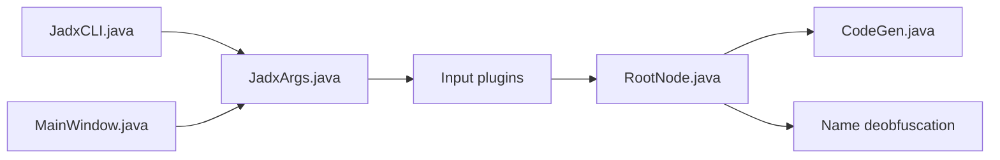

# skylot/jadx

> Décompilateur Dex vers Java, en ligne de commande et en interface graphique, pour APK et bytecode Android.

## Le problème
Auditer ou comprendre une application Android sans ses sources oblige à lire du bytecode Dalvik ou du smali.

## Ce que ça fait vraiment
Décompile APK, dex, aab, jar, class, aar et smali en code Java. Décode `AndroidManifest.xml` et les ressources. Désobfuscateur intégré. L'interface offre coloration, saut à la déclaration, recherche, renommage, débogueur smali. Système de plugins. Le README prévient que 100 % du code ne se décompile pas.

## Comment c'est branché


## Essayer
```bash
brew install jadx
jadx -d out classes.dex
```
Compilation : `./gradlew dist` (JDK 17+).

## Coût et pièges
Gratuit. Java 64 bits 11+ requis (inclus dans la variante `with-jre`). Des variables d'environnement désactivent les contrôles anti zip-bomb : à ne pas toucher sur des fichiers non fiables.

## Ce que ce n'est pas
Pas un décompilateur parfait : des erreurs sont attendues. Ne sert pas à modifier puis recompiler une app.

## Alternatives
Aucune alternative nommée dans le README.

## Pour toi
À ignorer pour la data/IA : outil d'analyse d'applications Android, utile uniquement en sécurité mobile.

