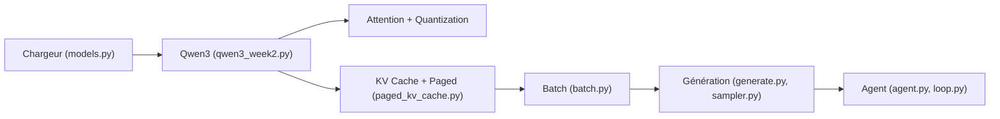

# skyzh/tiny-llm

> Hands-on course to understand LLM inference end to end by building Qwen3 on MLX.

## The problem
People use inference engines without understanding the path from tokens to logits: KV cache, batching, kernels.

## What it actually does
A four-week course on MLX arrays, with no high-level layers. W1: Qwen3 from `mlx.core` (attention, RoPE, GQA, RMSNorm, sampling). W2: KV cache, benchmarks, quantized and fused kernels (Python, C++, Metal). W3: mini vLLM with continuous batching and paged KV cache. W4: bounded code agent with checkpoints, receipts and compaction, published by milestones. `tiny_llm` receives your solutions, `tiny_llm_ref` holds the reference.

## How it is wired


## Trying it
```bash
pdm install -v
pdm run check-installation
pdm run test-refsol -- -- -k week_1
```

## Cost and gotchas
Free; designed for Apple silicon (MLX, Metal), Qwen3-4B quantized to 4 bits. Week 4 is published incrementally, so it is unfinished.

## What it is not
Not a ready-to-use serving engine; not for CUDA GPUs. You have to do the exercises to get anything out of it.

## Alternatives
CMU's Needle (cited as the training-side equivalent); vLLM is cited as the reference to approach.

## For you
Adopt if you want to master the internals of LLM inference on a Mac; on Linux/NVIDIA, the course loses its support.
