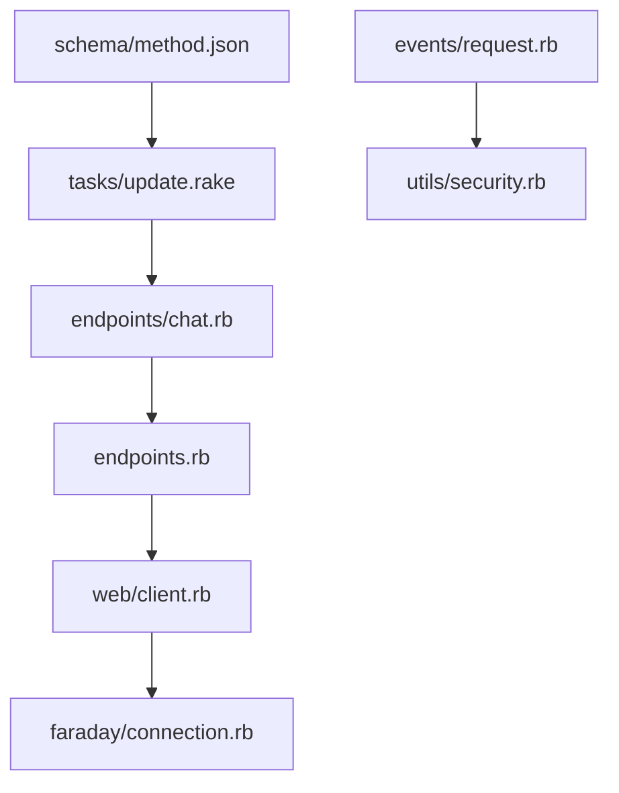

# slack-ruby/slack-ruby-client

> Ruby client for Slack's Web and Events APIs, with a command line.

## The problem
Calling the Slack API by hand (pagination, errors, signatures) is repetitive in Ruby.

## What it actually does
The endpoint files (chat.rb and others) are generated by update.rake from method.json and erb templates, grouped in endpoints.rb and used by Slack::Web::Client through a Faraday connection. It verifies Slack event signatures, formats messages, and provides the slack command.

## How it is wired


## Trying it
```bash
gem 'slack-ruby-client'   # dans le Gemfile
bundle install
gem install gli           # pour la commande slack
slack chat postMessage --text="hello world" --channel="#general"
```

## Cost and gotchas
Free but requires a Slack app and a token (SLACK_API_TOKEN). Ruby required (not listed in the prerequisites choices). RTM API support was split out.

## What it is not
Not a full bot: the README points to slack-ruby-bot-server-events for that.

## Alternatives
slack-ruby-bot-server-events for writing a full bot.

## For you
Ignore unless you notify Slack from Ruby; in Python, a native Slack client is more direct.
