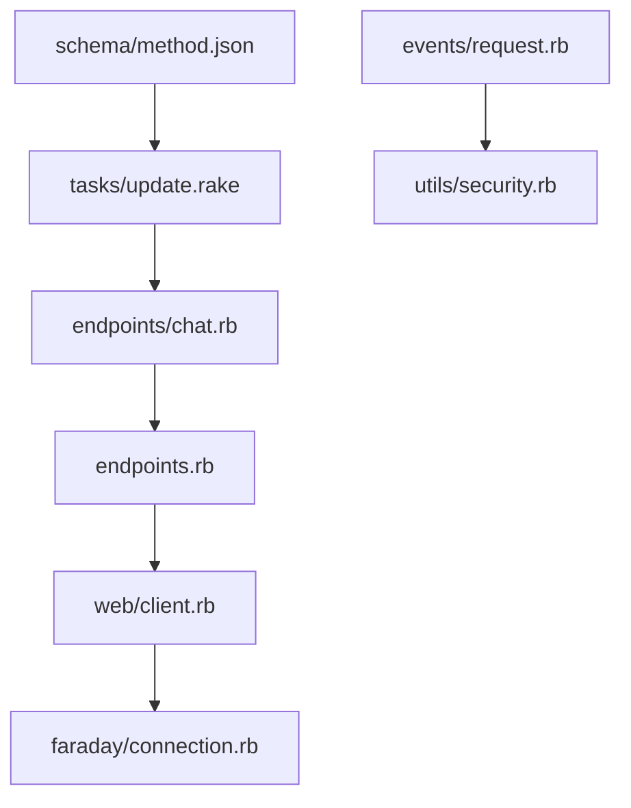

# slack-ruby/slack-ruby-client

> Client Ruby pour les API Web et Événements de Slack, avec une ligne de commande.

## Le problème
Appeler l'API Slack à la main (pagination, erreurs, signatures) est répétitif en Ruby.

## Ce que ça fait vraiment
Les fichiers d'endpoints (chat.rb et autres) sont générés par update.rake à partir de method.json et de templates erb, regroupés dans endpoints.rb et utilisés par Slack::Web::Client via une connexion Faraday. Il vérifie les signatures des événements Slack, formate les messages, et fournit la commande slack.

## Comment c'est branché


## Essayer
```bash
gem 'slack-ruby-client'   # dans le Gemfile
bundle install
gem install gli           # pour la commande slack
slack chat postMessage --text="hello world" --channel="#general"
```

## Coût et pièges
Gratuit mais exige une application Slack et un jeton (SLACK_API_TOKEN). Ruby requis (non listé dans le choix des prérequis). Le support de l'API RTM a été séparé.

## Ce que ce n'est pas
Pas un bot complet : le README renvoie à slack-ruby-bot-server-events pour cela.

## Alternatives
slack-ruby-bot-server-events pour écrire un bot complet.

## Pour toi
À ignorer sauf si tu notifies Slack depuis du Ruby ; en Python, un client Slack natif est plus direct.

