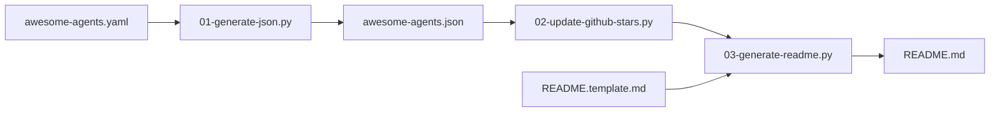

# slavakurilyak/awesome-ai-agents

> List of about 200 AI agent projects, ranked by stars, maintained by a consultant.

## The problem
AI agent projects are numerous and it is hard to find your way around.

## What it actually does
The README shows a Top 10 and a "Rising 10" with stars as of 2025-07-30, then an alphabetical list of about 200 names. The sections of the full list are present, but the descriptions are empty in the text provided. A pipeline of three Python scripts generates JSON, updates stars via the GitHub API and renders the README.

## How it is wired


## Trying it
No usage command: it is a list to read.
```bash
# rien à exécuter, liste à consulter
```

## Cost and gotchas
Free. The star counts date from 2025-07-30 and the last push from 2025-09-09; the file contains duplicates (Open Interpreter twice). The repository also serves to promote its author's services.

## What it is not
Not an evaluation: no comparison or selection criteria. 300 open issues.

## Alternatives
- No alternative named in the README.

## For you
Ignore: a frozen list, with no usable descriptions, to be replaced by your current GitHub watch.
