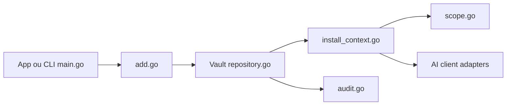

# sx — sleuth-io/sx

> Manager for versioned skills, agents, rules and MCP, shared through a synced folder or git.

## The problem
AI assets live in one repository and drift as soon as they are copied to another.

## What it actually does
A vault in a Dropbox/Drive folder, a git repository or the Skills.new service; an `sx.toml` manifest and a per-user lock, like npm. `sx add` adds, `sx install` distributes by scope (org, repo, path, team, bot, user) across several AI clients. Audit, usage statistics, cloud relay for claude.ai and chatgpt.com, Go library. The desktop app and the CLI share the configuration.

## How it is wired


## Trying it
```bash
brew install sleuth-io/tap/sx
sx init --type path --path ~/Dropbox/sx-vault
sx add ~/.claude/skills/my-skill
sx install my-skill --org
sx stats
```

## Cost and gotchas
Free locally or with git; Skills.new (centralized management) is the tier for large teams, price not specified. The cloud relay goes through skills.new.

## What it is not
Not a skills marketplace: a distribution tool. The content of the skills remains your business; the review flow (RBAC) is still on the roadmap.

## Alternatives
- Claude Code and Codex plugin marketplace: works without sx, but skills only.
- hetchy: runs agents unattended with sx.

## For you
Keep an eye on it: useful if your team shares several skills across tools; alone, a git repository is enough.
