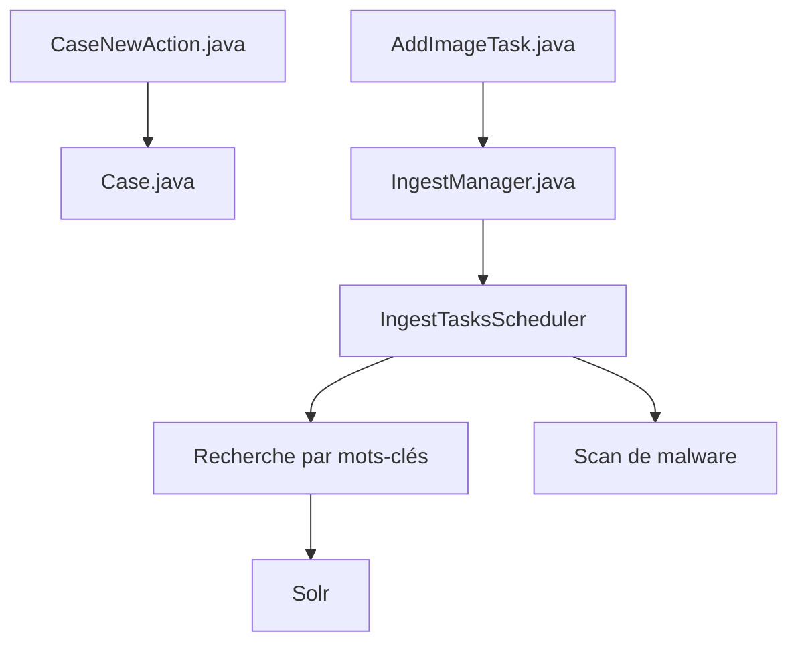

# sleuthkit/autopsy

> Digital forensics graphical interface built on The Sleuth Kit, for analyzing disk images and evidence.

## The problem
Analyzing a seized disk means chaining many command-line tools, with no unified view of the case.

## What it actually does
Java (NetBeans) application that manages investigation cases: adding disk images, scheduled ingestion by modules, keyword search via Solr, a cross-case correlation repository, recent activity analysis, multi-user work. A malware scanning module goes through a third-party cloud (CT).

## How it is wired

## Trying it
No command: on Windows, you use the provided installer with all dependencies.

## Cost and gotchas
Free. The README states Apache 2.0 but the catalog found no declared license. It also says only Windows is fully tested; 406 open issues.

## What it is not
Not an offensive tool: it is post-incident analysis. Not a cloud service, and not a turnkey solution on Linux or macOS according to the README.

## Alternatives
- The Sleuth Kit: the underlying library and command-line tools.

## For you
Watch: useful if you do incident response or data forensics, but outside the usual data and AI flow.
