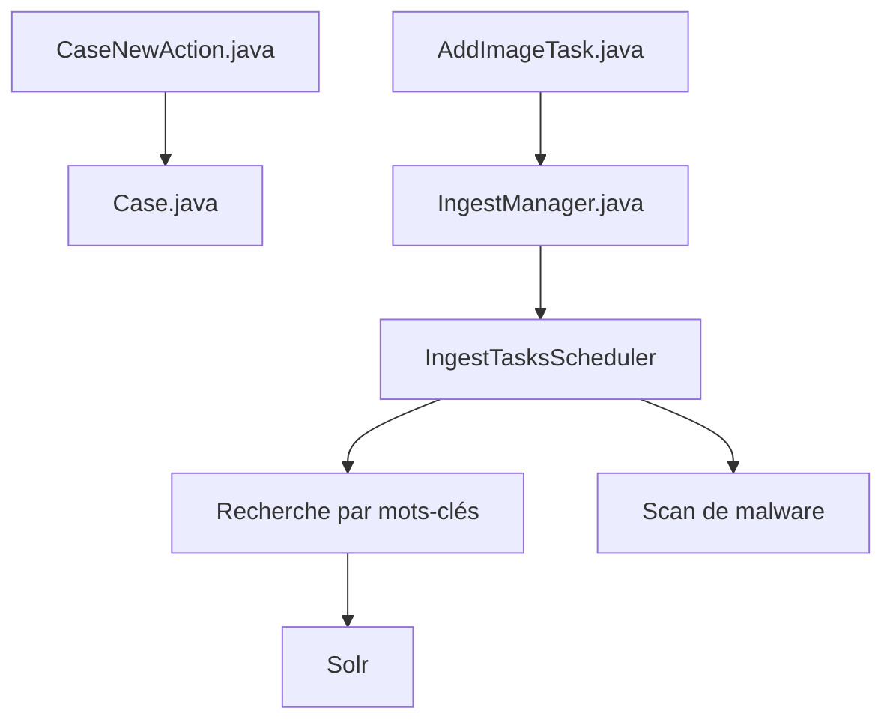

# sleuthkit/autopsy

> Interface graphique d'investigation numérique sur The Sleuth Kit, pour analyser des images disque et des preuves.

## Le problème
Analyser un disque saisi demande d'enchaîner de nombreux outils en ligne de commande, sans vue unifiée du dossier.

## Ce que ça fait vraiment
Application Java (NetBeans) qui gère des dossiers d'enquête : ajout d'images disque, ingestion planifiée par modules, recherche par mots-clés via Solr, dépôt de corrélation inter-dossiers, analyse de l'activité récente, travail multi-utilisateurs. Un module de scan de malware passe par un cloud tiers (CT).

## Comment c'est branché

## Essayer
Aucune commande : sous Windows, on utilise l'installeur fourni avec toutes les dépendances.

## Coût et pièges
Gratuit. Le README annonce Apache 2.0 mais le catalogue n'a trouvé aucune licence déclarée. Il dit aussi que seul Windows est entièrement testé ; 406 issues ouvertes.

## Ce que ce n'est pas
Pas un outil offensif : c'est de l'analyse post-incident. Pas un service cloud, et pas une solution clé en main sous Linux ou macOS selon le README.

## Alternatives
- The Sleuth Kit : la bibliothèque et les outils en ligne de commande sous-jacents.

## Pour toi
Surveiller : utile si tu fais de la réponse à incident ou du forensique sur des données, mais hors du flux data et IA courant.

