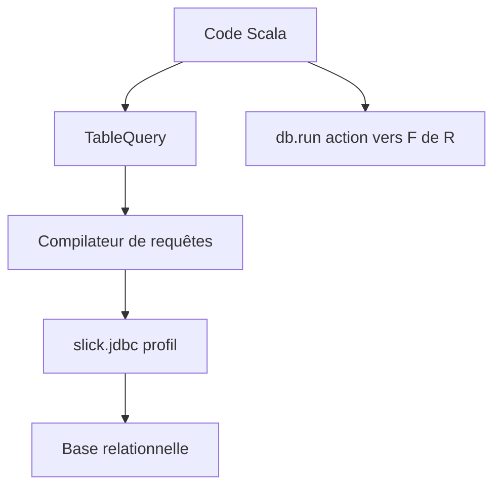

# slick/slick

> Scala library for accessing relational databases, with typed queries written like collections.

## The problem
Writing SQL as strings in Scala loses compiler safety and composition.

## What it actually does
Lets you write queries with an API close to Scala collections, checked at compile time, with a fallback to raw SQL. Generates SQL for several engines. Asynchronous API on Cats Effect 3 and FS2 streams. Schema can be generated from the database, metadata introspection API.

## How it is wired
Simplified diagram based on the fiche, no diagram provided.



## Trying it
```bash
# aucune commande shell dans le README
```
```scala
import slick.jdbc.PostgresProfile.api.*
val coffees = TableQuery[Coffees]
coffees += Coffee("Latte", 2.50)
coffees.filter(_.price < 10.0).sortBy(_.name)
```

## Cost and gotchas
Free, under the BSD-2-Clause license. Assumes a Scala project and a Maven dependency; no installation is detailed in the README.

## What it is not
Not a Python ORM nor a data science tool. Reserved for the Scala/JVM ecosystem.

## Alternatives
No alternative named in the README.

## For you
Ignore unless you use a Scala stack: nothing here serves a Python data/AI profile, but the repository is old and well maintained.
