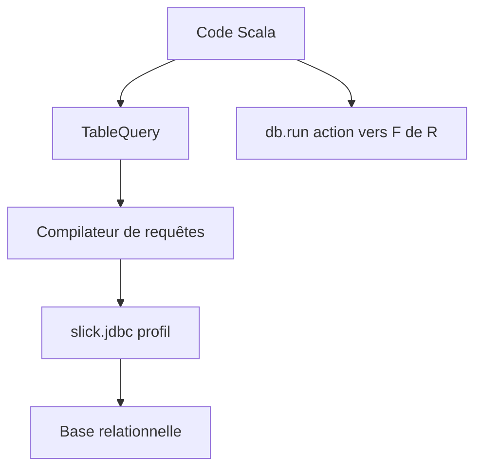

# slick/slick

> Bibliothèque Scala d'accès aux bases relationnelles, avec requêtes typées écrites comme des collections.

## Le problème
Écrire du SQL en chaînes en Scala fait perdre la sécurité du compilateur et la composition.

## Ce que ça fait vraiment
Permet d'écrire des requêtes avec une API proche des collections Scala, vérifiées à la compilation, avec repli possible vers du SQL brut. Génère le SQL pour plusieurs moteurs. API asynchrone sur Cats Effect 3 et flux FS2. Schéma pouvant être généré depuis la base, API d'introspection des métadonnées.

## Comment c'est branché
Schéma simplifié d'après la fiche, sans diagramme fourni.



## Essayer
```bash
# aucune commande shell dans le README
```
```scala
import slick.jdbc.PostgresProfile.api.*
val coffees = TableQuery[Coffees]
coffees += Coffee("Latte", 2.50)
coffees.filter(_.price < 10.0).sortBy(_.name)
```

## Coût et pièges
Gratuit, sous licence BSD-2-Clause. Suppose un projet Scala et une dépendance Maven ; aucune installation n'est détaillée dans le README.

## Ce que ce n'est pas
Pas un ORM Python ni un outil de data science. Réservé à l'écosystème Scala/JVM.

## Alternatives
Aucune alternative nommée dans le README.

## Pour toi
À ignorer sauf pile Scala : rien ici ne sert un profil Python data/IA, mais le dépôt est ancien et bien tenu.

