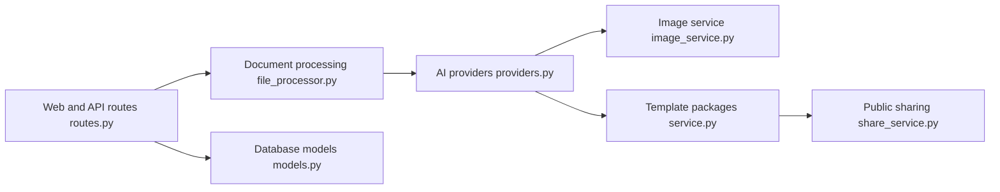

# sligter/LandPPT

> Web platform that generates editable presentations from a topic or a document, with speech and video.

## The problem
Producing a complete slide deck (outline, layout, images, speaker notes, exports) takes a long time.

## What it actually does
Four-step flow: requirements, outline, task tracking, parallel generation of HTML slides. AI sources: OpenAI, Claude, Gemini, Azure, Ollama and compatible APIs. Deep research (Tavily, SearXNG), images (local gallery, Pixabay/Unsplash, AI generation), speech and Edge-TTS narration with MP4 video export. Exports: PDF, HTML, PPTX, DOCX, Markdown.

## How it is wired


## Trying it
```bash
git clone https://github.com/sligter/LandPPT.git
cd LandPPT
uv sync --extra dev
cp .env.example .env
uv run python run.py
```

## Cost and gotchas
At least one AI provider key. Standard editable PPTX: commercial Apryse key (`APRYSE_LICENSE_KEY`); otherwise PPTX made of images, not editable. Default admin account `admin`/`admin123` to change in production. ffmpeg for video.

## What it is not
Not a free alternative to PowerPoint for every editable export. The README states Apache 2.0 but GitHub does not identify the license: to be checked.

## Alternatives
No alternative named in the README.

## For you
Worth watching: quick demo with SQLite, but the editable export depends on a third-party license and the maintainer is a single person.
