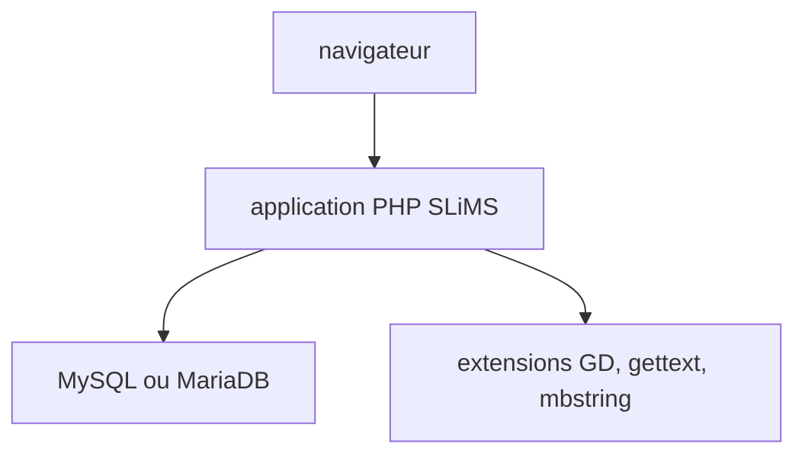

# slims/slims9_bulian

> Free library management software (catalog, loans, members) for libraries.

## The problem
Managing a library's books, journals, digital documents, loans and inventory without a dedicated tool.

## What it actually does
PHP web application: collection management, circulation, memberships and inventory. Requires PHP 8.1+, MySQL 5.7 or MariaDB 10.3, GD, gettext and mbstring extensions. A development `docker-compose` creates the database.

## How it is wired
Simplified diagram based on the sheet, no diagram provided.


## Trying it
```bash
cp .env.example .env
docker compose up -d --build
```

## Cost and gotchas
Free. Docker Desktop is required for the Docker route; otherwise install PHP and the database yourself.

## What it is not
Not a data or AI tool. 120 open issues: a heavy bug backlog.

## Alternatives
Not documented in the README.

## For you
Ignore: library management, outside the scope of data, AI or MLOps.
