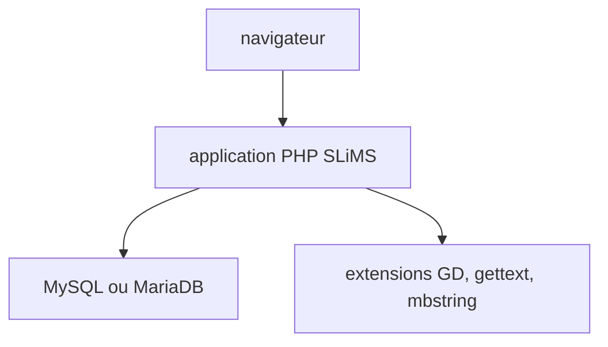

# slims/slims9_bulian

> Logiciel libre de gestion de bibliothèque (catalogue, prêts, adhérents) pour les bibliothèques.

## Le problème
Gérer livres, revues, documents numériques, prêts et inventaire d'une bibliothèque sans outil dédié.

## Ce que ça fait vraiment
Application web PHP : gestion de collection, circulation, adhésions et inventaire. Requiert PHP 8.1+, MySQL 5.7 ou MariaDB 10.3, extensions GD, gettext et mbstring. Un `docker-compose` de développement crée la base.

## Comment c'est branché
Schéma simplifié d'après la fiche, sans diagramme fourni.


## Essayer
```bash
cp .env.example .env
docker compose up -d --build
```

## Coût et pièges
Gratuit. Docker Desktop requis pour la voie Docker ; sinon installer PHP et base soi-même.

## Ce que ce n'est pas
Pas un outil data ou IA. 120 issues ouvertes : suivi de bugs chargé.

## Alternatives
Non documenté dans le README.

## Pour toi
À ignorer : gestion de bibliothèque, hors du périmètre data, IA ou MLOps.

