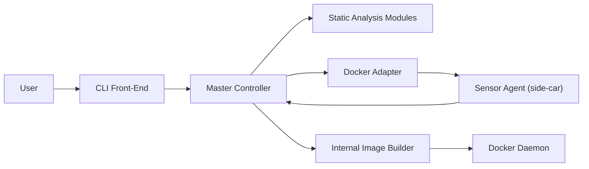

# slimtoolkit/slim

> CLI that analyzes a container image and produces a reduced version, with Seccomp/AppArmor profiles.

## The problem
Docker images carry useless OS, packages and tools: several hundred MB and a wide attack surface. Optimizing them by hand requires knowing every dependency.

## What it actually does
`slim build` launches a temporary container with a sensor that observes files and system calls (fanotify, ptrace) during HTTP probes or your tests.
It keeps only what was used and rebuilds a `.slim` image; examples cited are 30x smaller.
`xray` does static analysis and reconstructs the Dockerfile; `lint`, `debug`, `merge`, `registry`, `vulnerability` complete the set.
Generates Seccomp and AppArmor profiles; also works with Kubernetes for `debug`.

## How it is wired


## Trying it
```bash
curl -sL https://raw.githubusercontent.com/slimtoolkit/slim/master/scripts/install-slim.sh | sudo -E bash -
brew install docker-slim
docker pull dslim/slim
slim build my/sample-app
slim xray --target my/sample-app
```

## Cost and gotchas
Free, requires a Docker daemon. Applications that load code dynamically require probes or `--include-path`, otherwise the minified image breaks.

## What it is not
Not magic: without exercising every path of the application, needed files disappear. The README also pushes the commercial Root.io offering, distinct from the tool.

## Alternatives
No alternative named in the README.

## For you
Worth adopting for your ML serving images: shrinking Python images by several hundred MB without rewriting the Dockerfile pays off quickly, provided you test the final image.
