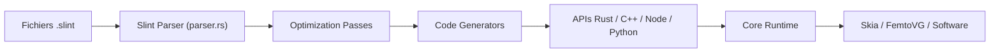

# slint-ui/slint

> Declarative native UI toolkit for embedded, desktop and mobile, in Rust, C++, JS or Python.

## The problem
Writing lightweight native interfaces that work across several platforms and languages.

## What it actually does
You describe the interface in a `.slint` language compiled ahead of time to Rust, C++, or interpreted for JS/Python (beta). Runtime with properties, layout, windows, three rendering engines (femtovg/OpenGL ES, Skia, software). Tools: LSP server, VS Code extension, viewer, SlintPad, Figma plugin.

## How it is wired


## Trying it
```slint
export component HelloWorld inherits Window {
    width: 400px;
    height: 400px;
    Text { text: "Hello, world"; color: blue; }
}
```

## Cost and gotchas
License present but not identified by GitHub: read it before any commercial use. The `qt` style requires Qt to be installed. 738 open issues.

## What it is not
Not a web application. The Node and Python APIs are still in beta.

## Alternatives
No alternative named in the README.

## For you
Little connection to data/AI; ignore unless you need a native interface for an internal tool.
