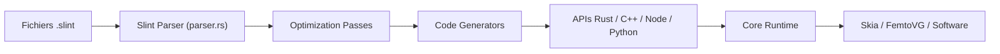

# slint-ui/slint

> Boîte à outils d'interfaces déclaratives natives pour embarqué, bureau et mobile, en Rust, C++, JS ou Python.

## Le problème
Écrire des interfaces natives légères qui fonctionnent sur plusieurs plateformes et langages.

## Ce que ça fait vraiment
On décrit l'interface dans un langage `.slint` compilé en amont vers Rust, C++, ou interprété pour JS/Python (bêta). Runtime avec propriétés, layout, fenêtres, trois moteurs de rendu (femtovg/OpenGL ES, Skia, logiciel). Outils : serveur LSP, extension VS Code, visionneuse, SlintPad, plugin Figma.

## Comment c'est branché


## Essayer
```slint
export component HelloWorld inherits Window {
    width: 400px;
    height: 400px;
    Text { text: "Hello, world"; color: blue; }
}
```

## Coût et pièges
Licence présente mais non identifiée par GitHub : à lire avant un usage commercial. Le style `qt` demande Qt installé. 738 issues ouvertes.

## Ce que ce n'est pas
Pas une application web. Les API Node et Python sont encore en bêta.

## Alternatives
Aucune alternative nommée dans le README.

## Pour toi
Peu de lien avec le data/IA ; à ignorer sauf besoin d'une interface native pour un outil interne.

