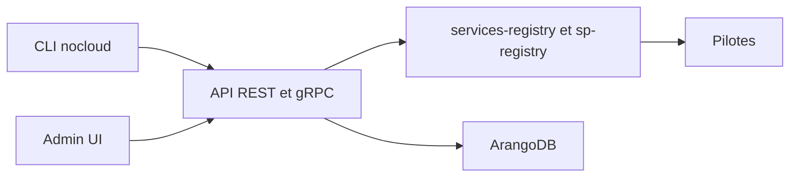

# slntopp/nocloud

> Open source cloud management framework, with drivers, API and CLI, for infrastructure operators.

## The problem
Managing several infrastructure platforms requires separate tools. A hosting provider or an internal team wants a single orchestration layer.

## What it actually does
NoCloud runs in any OCI environment (Docker Compose, Kubernetes). Drivers, added through the `DRIVERS` environment variable, create groups and instances. An admin interface, a REST and gRPC API and a `nocloud` CLI are provided. The services mentioned are Traefik, RabbitMQ and ArangoDB.

## How it is wired
Simplified diagram based on the fiche, no diagram provided.



## Trying it
```bash
docker-compose up
snap install nocloud
brew tap slntopp/nocloud
brew install nocloud
```

## Cost and gotchas
Entries must be added to `/etc/hosts` for local mode. Production deployment is referred to other documentation.

## What it is not
Not a cloud in itself: without a driver, it orchestrates nothing. The README does not say which drivers exist, apart from the IONe example.

## Alternatives
No alternative named in the README.

## For you
Worth watching: unrelated to models directly, but relevant if you need to expose an infrastructure platform internally.
