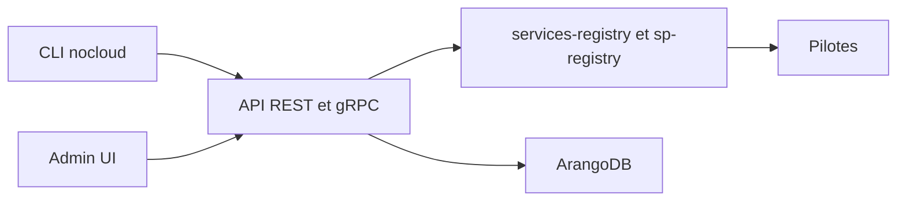

# slntopp/nocloud

> Framework open source de gestion de cloud, avec pilotes, API et CLI, pour opérateurs d'infrastructure.

## Le problème
Gérer plusieurs plateformes d'infrastructure demande des outils séparés. Un hébergeur ou une équipe interne veut une couche unique d'orchestration.

## Ce que ça fait vraiment
NoCloud tourne dans tout environnement OCI (Docker Compose, Kubernetes). Des pilotes, ajoutés par variable d'environnement `DRIVERS`, créent groupes et instances. Une interface d'administration, une API REST et gRPC et un CLI `nocloud` sont fournis. Les services cités sont Traefik, RabbitMQ et ArangoDB.

## Comment c'est branché
Schéma simplifié d'après la fiche, sans diagramme fourni.



## Essayer
```bash
docker-compose up
snap install nocloud
brew tap slntopp/nocloud
brew install nocloud
```

## Coût et pièges
Il faut ajouter des entrées dans `/etc/hosts` pour le mode local. Le déploiement en production est renvoyé à une autre documentation.

## Ce que ce n'est pas
Pas un cloud en soi : sans pilote, il n'orchestre rien. Le README ne dit pas quels pilotes existent, hormis l'exemple IONe.

## Alternatives
Aucune alternative nommée dans le README.

## Pour toi
À surveiller : sans rapport direct avec les modèles, mais pertinent si tu dois exposer une plateforme d'infrastructure en interne.

