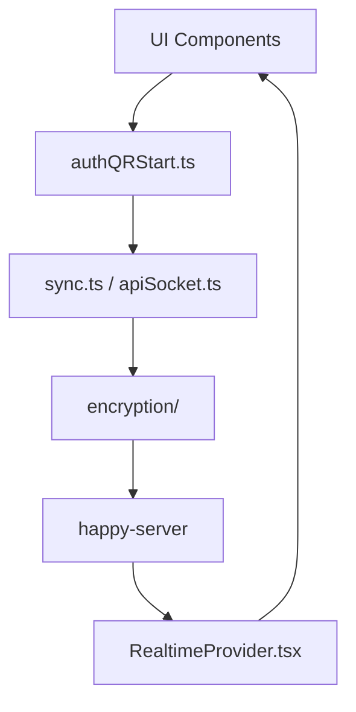

# slopus/happy

> End-to-end encrypted mobile, web and CLI client to drive Claude Code and Codex from your phone.

## The problem
A coding agent launched on your workstation stops as soon as you step away from the desk, with no way to follow it or restart it.

## What it actually does
The `happy` CLI wraps Claude Code or Codex; an Expo app (iOS/Android/web, Tauri desktop) finds the sessions again through a relay server that synchronizes encrypted data. QR authentication, push notifications, voice session. The README also announces multi-model and shared sessions.

## How it is wired


## Trying it
```bash
npm install -g happy
happy claude
happy codex
```

## Cost and gotchas
Existing Claude/Codex subscriptions at your expense; a relay server is involved (the project's or one you host).

## What it is not
Not an agent in itself: a wrapper around existing harnesses. The original CLI is taking a back seat to the desktop app and Happy Harness.

## Alternatives
No alternative named.

## For you
Watch: handy for following long agent runs from mobile, but adds a third-party relay to vet.
