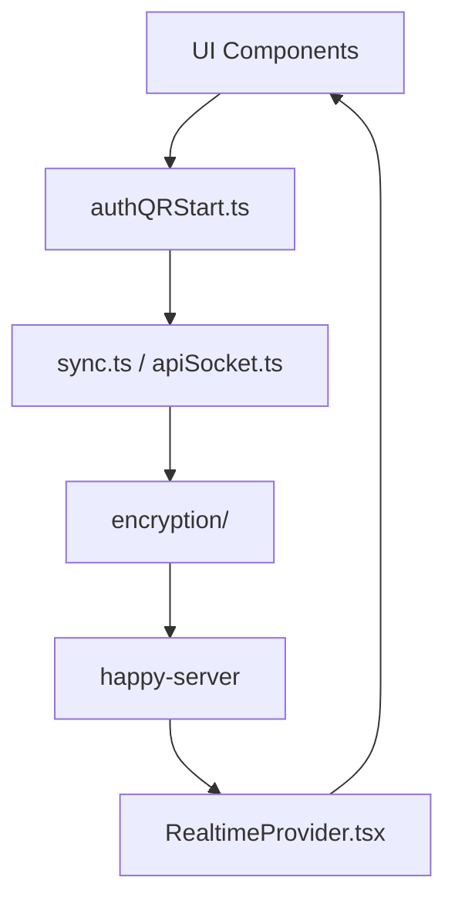

# slopus/happy

> Client mobile, web et CLI chiffré de bout en bout pour piloter Claude Code et Codex depuis son téléphone.

## Le problème
Un agent de code lancé sur le poste s'arrête dès qu'on s'éloigne du bureau, sans moyen de le suivre ni de le relancer.

## Ce que ça fait vraiment
Le CLI `happy` enveloppe Claude Code ou Codex ; une app Expo (iOS/Android/web, desktop Tauri) retrouve les sessions via un serveur relais qui synchronise des données chiffrées. Authentification par QR, notifications push, session vocale. Le README annonce aussi multi-modèles et sessions partagées.

## Comment c'est branché


## Essayer
```bash
npm install -g happy
happy claude
happy codex
```

## Coût et pièges
Abonnements Claude/Codex existants à ta charge ; un serveur relais est impliqué (celui du projet ou à héberger).

## Ce que ce n'est pas
Pas un agent en soi : un enrobage de harnais existants. Le CLI d'origine est en retrait au profit du desktop et de Happy Harness.

## Alternatives
Aucune alternative nommée.

## Pour toi
Surveiller : pratique pour suivre des runs d'agents longs depuis le mobile, mais ajoute un relais tiers à valider.

