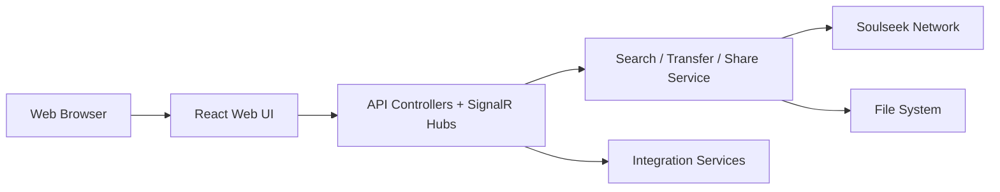

# slskd/slskd

> Web client-server for the Soulseek file-sharing network, self-hostable in Docker.

## The problem
The official Soulseek client is a desktop application; you cannot leave it running on a server and reach it from a browser.

## What it actually does
A daemon or container exposing a web interface (search, sorted results, downloads, share browsing, chat rooms). ASP.NET Core backend with REST controllers, SignalR hubs, services (search, transfers, shares, messaging) and integrations (FTP, Pushbullet, webhooks, scripts).

## How it is wired


## Trying it
```bash
docker run -d \
  -p 5030:5030 \
  -p 5031:5031 \
  -p 50300:50300 \
  -e SLSKD_REMOTE_CONFIGURATION=true \
  -v <path/to/application/data>:/app \
  --name slskd \
  --user 1000:1000 \
  slskd/slskd:latest
```

## Cost and gotchas
Free. Soulseek credentials must be entered in `slskd.yml`. Default login `slskd` / `slskd`: change it before any internet exposure. `SLSKD_REMOTE_CONFIGURATION` is discouraged for public exposure.

## What it is not
Not a data search tool: it is a file-sharing client. Depends on the Soulseek network and its rules.

## Alternatives
The official Soulseek client (cited in the README): for those who prefer the desktop.

## For you
Ignore: music self-hosting unrelated to data/AI; the Docker example is clean but outside your profile.
