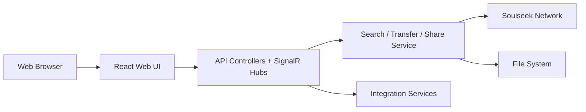

# slskd/slskd

> Client-serveur web pour le réseau de partage de fichiers Soulseek, auto-hébergeable en Docker.

## Le problème
Le client officiel Soulseek est un logiciel de bureau ; impossible de le laisser tourner sur un serveur et d'y accéder depuis un navigateur.

## Ce que ça fait vraiment
Démon ou conteneur exposant une interface web (recherche, résultats triés, téléchargements, navigation des partages, salons de discussion). Backend ASP.NET Core avec contrôleurs REST, hubs SignalR, services (recherche, transferts, partages, messagerie) et intégrations (FTP, Pushbullet, webhooks, scripts).

## Comment c'est branché


## Essayer
```bash
docker run -d \
  -p 5030:5030 \
  -p 5031:5031 \
  -p 50300:50300 \
  -e SLSKD_REMOTE_CONFIGURATION=true \
  -v <path/to/application/data>:/app \
  --name slskd \
  --user 1000:1000 \
  slskd/slskd:latest
```

## Coût et pièges
Gratuit. Identifiants Soulseek à saisir dans `slskd.yml`. Login par défaut `slskd` / `slskd` : à changer avant toute exposition internet. `SLSKD_REMOTE_CONFIGURATION` déconseillé en exposition publique.

## Ce que ce n'est pas
Pas un outil de recherche de données : c'est un client de partage de fichiers. Dépend du réseau Soulseek et de ses règles.

## Alternatives
Le client officiel Soulseek (cité dans le README) : pour ceux qui préfèrent le bureau.

## Pour toi
Ignorer : self-hosting musical sans lien avec data/IA ; l'exemple est propre côté Docker mais hors de ton profil.

