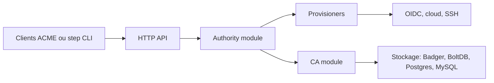

# smallstep/certificates

> step-ca: an online certificate authority to automatically issue and renew TLS and SSH certificates.

## The problem
Setting up a private PKI is out of reach for many small teams, and long-lived certificates are hard to manage.

## What it actually does
Issues HTTPS and client certificates, as well as SSH certificates for people and hosts. Each request is authorized by a provisioner: ACME, OIDC token, cloud identity document (AWS, GCP, Azure), JWK token, X.509 certificate, SCEP, etc. Certificates are short-lived with automatic renewal. Storage goes through Badger, BoltDB, Postgres or MySQL. The reference client is the `step` CLI.

## How it is wired


## Trying it
The README points to the installation documentation and gives no install command. Only the CLI help is provided:
```bash
step help --http=:8080
```

## Cost and gotchas
Free. The README steers toward the commercial offering for: multiple CAs, active revocation (CRL, OCSP), high availability, web interface, HSM, FIPS, EAB.

## What it is not
Not a multi-CA PKI nor a turnkey high-availability product: `step-ca` targets a two-tier PKI for DevOps. Revocation is "passive" (short-lived certificates).

## Alternatives
No alternative named in the README (Smallstep's commercial offering is cited for advanced needs).

## For you
Keep an eye on it: useful the day your internal ML services need mutual TLS or a private ACME, without being a data tool to install by default.
