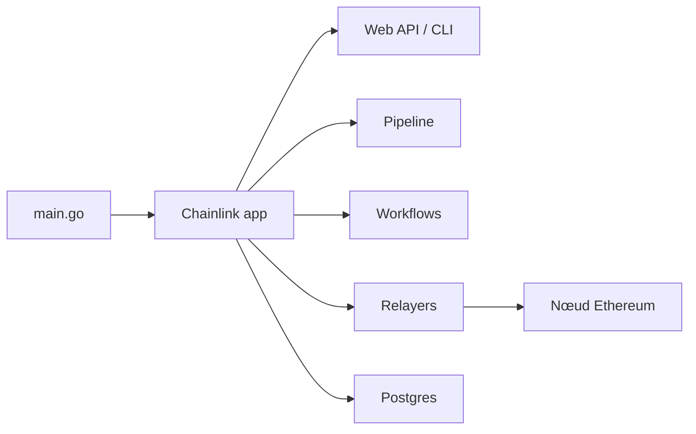

# smartcontractkit/chainlink

> Chainlink oracle node in Go, linking smart contracts to off-chain data.

## The problem
Smart contracts have no access to real-world data or off-chain computation without a trusted third party.

## What it actually does
A long-running node binary backed by Postgres, configured with TOML and environment variables.
A job pipeline engine (HTTP, parsing, ETH calls and transactions), plus a workflows/capabilities subsystem.
Protocol services: OCR, VRF, CCIP, Functions, multi-chain relayers.
Web UI, GraphQL API and administration CLI on port 6688.

## How it is wired


## Trying it
```bash
git clone https://github.com/smartcontractkit/chainlink && cd chainlink
make install
chainlink node start
```

## Cost and gotchas
You need Go, Node 20, pnpm, Postgres and an Ethereum node with websocket. Some plugins require a GITHUB_TOKEN for private repositories.

## What it is not
Not a contract development library nor a data tool. Nethermind and Erigon are "supported but broken".

## Alternatives
No alternative named in the README.

## For you
Ignore: this is blockchain infrastructure for node operators, unrelated to data, AI or MLOps work.
