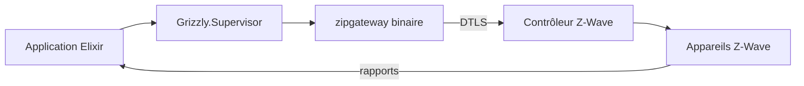

# smartrent/grizzly

> Elixir library for controlling a Z-Wave network, aimed at IoT device developers.

## The problem
Talking to Z-Wave devices (plugs, locks) means handling the protocol, pairing and security by hand.

## What it actually does
It starts and supervises Silicon Labs' `zipgateway` binary, connected over DTLS, and exposes Elixir calls: node inclusion and exclusion, sending commands (`switch_binary_set`), subscribing to unsolicited messages. Commands for sleeping devices are queued.

## How it is wired
Simplified diagram based on the fiche, no diagram provided.



## Trying it
```bash
iex> Grizzly.Inclusions.add_node()
iex> Grizzly.send_command(5, :switch_binary_set, target_value: :on)
```
Mix dependency: `{:grizzly, "~> 5.2"}`.

## Cost and gotchas
Z-Wave hardware is mandatory, and the `zipgateway` binary must be compiled, which requires a free Silicon Labs account. Installation under Nerves is described as a work in progress.

## What it is not
It is not a ready-to-use tool for end users. It needs an Elixir environment and hardware.

## Alternatives
- zipgateway-env: Docker container to build and run zipgateway locally.

## For you
Ignore: Z-Wave home automation in Elixir, unrelated to data, AI or MLOps work.
