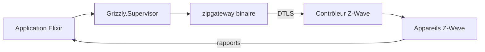

# smartrent/grizzly

> Bibliothèque Elixir pour piloter un réseau Z-Wave, destinée aux développeurs d'objets connectés.

## Le problème
Parler à des appareils Z-Wave (prises, serrures) demande de gérer le protocole, l'appairage et la sécurité à la main.

## Ce que ça fait vraiment
Elle démarre et supervise le binaire `zipgateway` de Silicon Labs, relié en DTLS, et expose des appels Elixir : inclusion et exclusion de nœuds, envoi de commandes (`switch_binary_set`), abonnement aux messages non sollicités. Les appareils endormis voient leurs commandes mises en file.

## Comment c'est branché
Schéma simplifié d'après la fiche, sans diagramme fourni.



## Essayer
```bash
iex> Grizzly.Inclusions.add_node()
iex> Grizzly.send_command(5, :switch_binary_set, target_value: :on)
```
Dépendance Mix : `{:grizzly, "~> 5.2"}`.

## Coût et pièges
Matériel Z-Wave obligatoire, et binaire `zipgateway` à compiler, ce qui demande un compte gratuit chez Silicon Labs. L'installation sous Nerves est décrite comme en cours de rédaction.

## Ce que ce n'est pas
Ce n'est pas un outil prêt à l'emploi pour utilisateur final. Il faut un environnement Elixir et du matériel.

## Alternatives
- zipgateway-env : conteneur Docker pour compiler et lancer zipgateway en local.

## Pour toi
Ignorer : domotique Z-Wave en Elixir, sans lien avec un travail data, IA ou MLOps.

