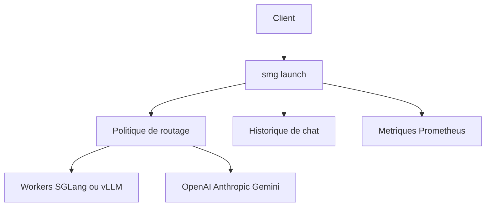

# smg-project/smg

> Rust gateway that distributes requests across LLM inference engines and cloud providers, for large-scale deployments.

## The problem
With several engines (SGLang, vLLM…) and cloud APIs, you need a single entry point that balances load without wasting the KV cache.

## What it actually does
Exposes a unified API (OpenAI, Anthropic Messages, Gemini, Responses). Ten routing policies including `cache_aware`, which reuses prefixes via radix trees. Handles Kubernetes discovery, conversation history (PostgreSQL, Oracle, Redis), MCP tools, WASM plugins, Prometheus metrics and OpenTelemetry traces.

## How it is wired

Simplified diagram based on the sheet, no diagram provided.

## Trying it
```bash
docker pull lightseekorg/smg:latest
pip install smg
smg launch --worker-urls http://gpu1:8000 http://gpu2:8000 --policy cache_aware
curl http://localhost:30000/v1/chat/completions \
  -H "Content-Type: application/json" \
  -d '{"model": "llama3", "messages": [{"role": "user", "content": "Hello!"}]}'
```

## Cost and gotchas
Assumes inference workers are already deployed, so GPUs are at your expense. 174 open issues: the project moves fast. Cargo requires `protoc`.

## What it is not
Not an inference engine: it routes to them. Not a tool for a single local model on a laptop.

## Alternatives
No alternative cited in the README.

## For you
Adopt if you serve several models on GPUs: it covers routing, observability and multi-provider, with an Apache-2.0 license and very recent activity.
