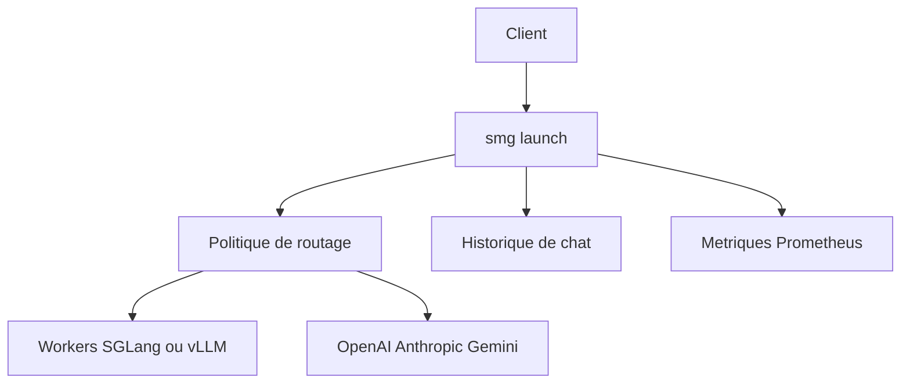

# smg-project/smg

> Passerelle Rust qui répartit les requêtes entre moteurs d'inférence LLM et fournisseurs cloud, pour déploiements à grande échelle.

## Le problème
Avec plusieurs moteurs (SGLang, vLLM…) et des API cloud, il faut un point d'entrée unique qui équilibre la charge sans gaspiller le cache KV.

## Ce que ça fait vraiment
Expose une API unifiée (OpenAI, Anthropic Messages, Gemini, Responses). Dix politiques de routage dont `cache_aware`, qui réutilise les préfixes via des arbres radix. Gère découverte Kubernetes, historique de conversations (PostgreSQL, Oracle, Redis), outils MCP, plugins WASM, métriques Prometheus et traces OpenTelemetry.

## Comment c'est branché

Schéma simplifié d'après la fiche, sans diagramme fourni.

## Essayer
```bash
docker pull lightseekorg/smg:latest
pip install smg
smg launch --worker-urls http://gpu1:8000 http://gpu2:8000 --policy cache_aware
curl http://localhost:30000/v1/chat/completions \
  -H "Content-Type: application/json" \
  -d '{"model": "llama3", "messages": [{"role": "user", "content": "Hello!"}]}'
```

## Coût et pièges
Suppose des workers d'inférence déjà déployés, donc des GPU à ta charge. 174 issues ouvertes : le projet bouge vite. Cargo demande `protoc`.

## Ce que ce n'est pas
Pas un moteur d'inférence : il route vers eux. Pas un outil pour un seul modèle local sur un portable.

## Alternatives
Aucune alternative citée dans le README.

## Pour toi
À adopter si tu sers plusieurs modèles sur des GPU : il couvre routage, observabilité et multi-fournisseurs, avec une licence Apache-2.0 et une activité très récente.

