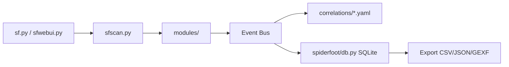

# smicallef/spiderfoot

> Automates open-source intelligence (OSINT) collection on a domain, an IP or an identity.

## The problem
Manually listing what an organization or a person exposes on the Internet means querying dozens of sources one by one, then cross-checking the results.

## What it actually does
More than 200 modules query public APIs, reputation lists or local tools (DNSTwist, Nmap, Nuclei…) and pass their findings to each other using a publish/subscribe model. A correlation engine, driven by 37 YAML rules, cross-references the results. Everything is stored in SQLite, viewable through the embedded web interface or on the command line, and exportable as CSV, JSON or GEXF. Targets range from an IP to a person's name, including an email address.

## How it is wired


## Trying it
```bash
wget https://github.com/smicallef/spiderfoot/archive/v4.0.tar.gz
tar zxvf v4.0.tar.gz
cd spiderfoot-4.0
pip3 install -r requirements.txt
python3 ./sf.py -l 127.0.0.1:5001
```

## Cost and gotchas
Free and MIT licensed. Most modules do not require a key; some have a free tier, others are paid. The README recommends the packaged release over master, which is less tested. Python 3.7 minimum.

## What it is not
Not a tool to point at any target: the README mentions both offensive (penetration testing) and defensive use; it is only justified on a scope you own or have a mandate for. Some modules query personal data (names, phone numbers, leaks): the legal framework (GDPR in particular) applies. Continuous monitoring and multi-user features belong to the commercial version, SpiderFoot HX.

## Alternatives
- SpiderFoot HX: hosted and managed version, with attack surface monitoring.

## For you
Watch: useful for mapping what an organization exposes, but little related to everyday data/AI work, and a single maintainer.
