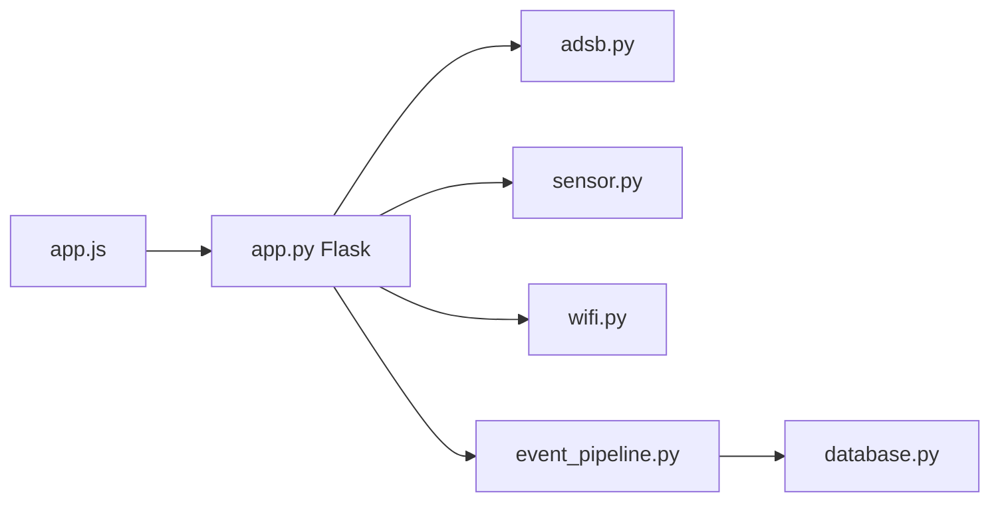

# smittix/intercept

> Web interface for driving software-defined radio tools: aircraft, ships, pagers, satellites, WiFi.

## The problem
SDR tools (rtl_433, dump1090, multimon-ng…) are used separately, on the command line, each in its own way.

## What it actually does
A Flask application bundles several modes: pager decoding, 433 MHz sensors, ADS-B and AIS tracking, ACARS, weather satellites, APRS, WiFi and Bluetooth scanning, GPS, drone detection, TSCM, Meshtastic. Events are pushed over SSE/WebSocket, with remote agents and optional ADS-B history in PostgreSQL. Typical hardware: an RTL-SDR dongle.

## How it is wired


## Trying it
```bash
git clone https://github.com/smittix/intercept.git
cd intercept
./setup.sh
sudo ./start.sh
```

## Cost and gotchas
SDR hardware (about $25-35), Docker privileged mode, default credentials `admin / admin` to change before exposing it. Listening to communications is subject to legal authorization.

## What it is not
Not a purely software tool. The README states it was developed with the help of AI.

## Alternatives
No named alternative; it wraps rtl-sdr, dump1090, SatDump, direwolf, among others.

## For you
Ignore: radio/SDR domain with no link to data or MLOps, and it requires dedicated hardware.
