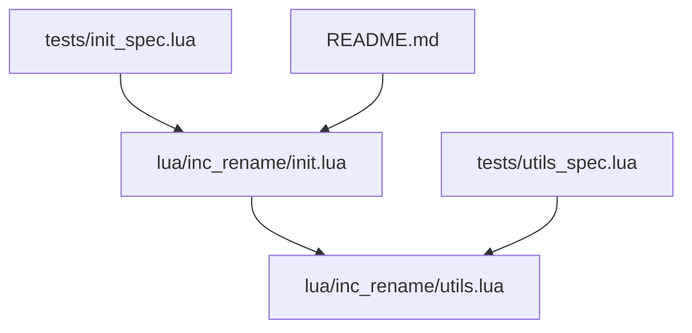

# smjonas/inc-rename.nvim

> Small Neovim plugin that previews LSP renames live as you type.

## The problem
A standard LSP rename shows nothing before you confirm, so you don't know what will change.

## What it actually does
The `:IncRename` command replaces occurrences live using Neovim's command preview. It can use noice.nvim, dressing.nvim or snacks.nvim for input. With `inccommand=split`, a buffer lists all affected identifiers across several files.

## How it is wired
Schema derived from the code diagram.


## Trying it
```lua
-- lazy.nvim : { "smjonas/inc-rename.nvim", opts = {} }
vim.keymap.set("n", "<leader>rn", ":IncRename ")
```

## Cost and gotchas
Free. Neovim 0.8 or later and an active LSP. Known conflicts with `traces.vim` and `custom-elements-languageserver`. Remember `:wa` after a multi-file rename.

## What it is not
Not a refactoring engine: it uses the rename of your LSP server.

## Alternatives
No alternative named in the README.

## For you
Worth watching if you refactor Python in Neovim: small, useful, no risk.
