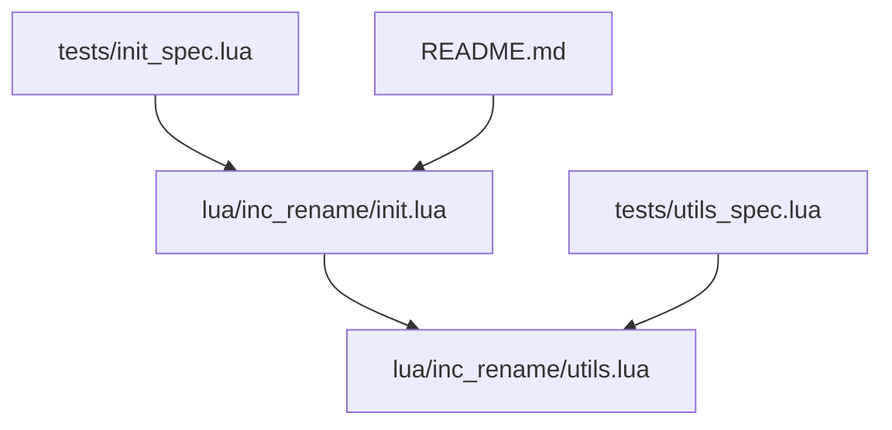

# smjonas/inc-rename.nvim

> Petit plugin Neovim qui prévisualise en direct les renommages LSP pendant la saisie.

## Le problème
Un renommage LSP classique n'affiche rien avant validation, on ne sait pas ce qui change.

## Ce que ça fait vraiment
La commande `:IncRename` remplace les occurrences en direct grâce à la prévisualisation de commande de Neovim. Elle peut utiliser noice.nvim, dressing.nvim ou snacks.nvim pour la saisie. Avec `inccommand=split`, un tampon liste tous les identifiants touchés dans plusieurs fichiers.

## Comment c'est branché
Schéma d'après le diagramme du code.


## Essayer
```lua
-- lazy.nvim : { "smjonas/inc-rename.nvim", opts = {} }
vim.keymap.set("n", "<leader>rn", ":IncRename ")
```

## Coût et pièges
Gratuit. Neovim 0.8 ou plus et un LSP actif. Des conflits connus avec `traces.vim` et `custom-elements-languageserver`. Penser à `:wa` après un renommage multi-fichiers.

## Ce que ce n'est pas
Pas un moteur de refactoring : il utilise le renommage de ton serveur LSP.

## Alternatives
Aucune alternative nommée dans le README.

## Pour toi
À surveiller si tu refactores du Python dans Neovim : petit, utile, sans risque.

