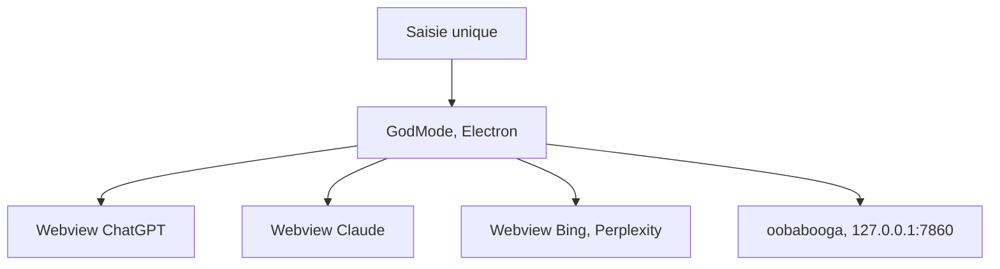

# smol-ai/GodMode

> Desktop browser that sends the same prompt to several web chatbots at once.

## The problem
Comparing ChatGPT, Claude and others means opening several tabs and retyping the prompt.

## What it actually does
Electron application that displays the assistants' real web apps in panes and copies your input into all of them. Global shortcut (Cmd+Shift+G), resizable panes, support for a local oobabooga and a Llama 2-based "Prompt Critic". Accounts are handled on the provider side.

## How it is wired

Simplified diagram based on the sheet, no diagram provided.

## Trying it
```bash
git clone https://github.com/smol-ai/GodMode.git
cd GodMode
npm install --force
npm run start
```

## Cost and gotchas
Free, but you need accounts with each provider. Google authentication is described as finicky. Windows and Linux: "a lot of work to do".

## What it is not
Not an evaluation tool: it measures nothing. The last push dates from July 2024 and the README cites Claude 2 and Bard, which have since disappeared or been renamed: features are probably broken (light/dark mode already is).

## Alternatives
ChatALL, cited in the README: same idea, different experience.

## For you
Ignore: a 2024 project that depends on web pages that have since changed; an API-based comparer will be more reliable.
