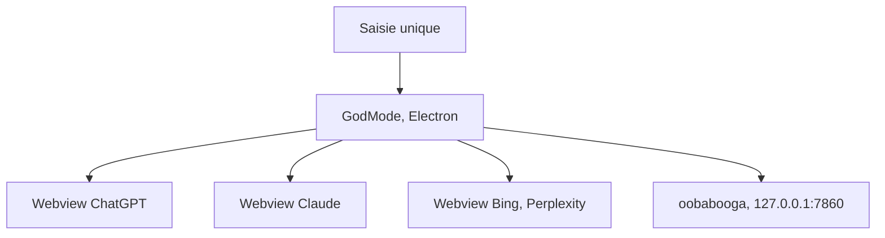

# smol-ai/GodMode

> Navigateur de bureau qui envoie un même prompt à plusieurs chatbots web à la fois.

## Le problème
Comparer ChatGPT, Claude et d'autres oblige à ouvrir plusieurs onglets et à retaper le prompt.

## Ce que ça fait vraiment
Application Electron qui affiche les vraies applis web des assistants dans des volets et recopie la saisie dans tous. Raccourci global (Cmd+Shift+G), volets redimensionnables, prise en charge d'oobabooga en local et d'un « Prompt Critic » basé sur Llama 2. Les comptes se font côté fournisseurs.

## Comment c'est branché

Schéma simplifié d'après la fiche, sans diagramme fourni.

## Essayer
```bash
git clone https://github.com/smol-ai/GodMode.git
cd GodMode
npm install --force
npm run start
```

## Coût et pièges
Gratuit, mais il faut des comptes chez chaque fournisseur. L'authentification Google est décrite comme capricieuse. Windows et Linux : « beaucoup de travail à faire ».

## Ce que ce n'est pas
Pas un outil d'évaluation : il ne mesure rien. Le dernier push date de juillet 2024 et le README cite Claude 2 et Bard, disparus ou renommés depuis : fonctions probablement cassées (le mode clair/sombre l'est déjà).

## Alternatives
ChatALL, cité dans le README : même idée, expérience différente.

## Pour toi
À ignorer : projet daté de 2024, dépendant de pages web qui ont changé ; un comparateur par API sera plus fiable.

