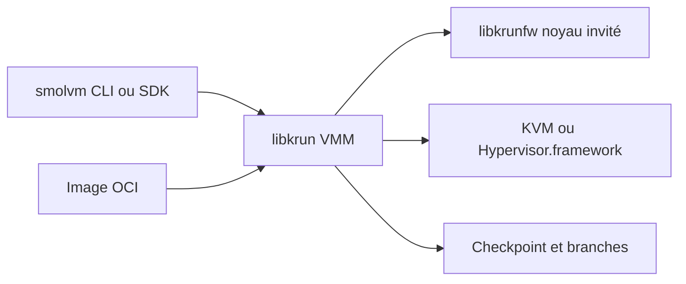

# smol-machines/smolvm

> Local, embeddable and branchable micro virtual machines, to isolate AI agent workloads.

## The problem
A container shares the host kernel, and a classic VM starts slowly: awkward for running code generated by an agent.

## What it actually does
Each workload runs in a hardware VM with its own kernel (libkrun, on KVM, Hypervisor.framework or Windows Hypervisor Platform). Any OCI image starts without a Docker daemon, in under a second. The network is cut by default and can be limited to named hosts; a secret can be used without the workload reading it. You can save a running machine, branch it into copies, or package it as a `.smolmachine` file. Node, Python, Rust and Go SDKs.

## How it is wired
Simplified diagram based on the fiche, no diagram provided.


## Trying it
```bash
curl -sSL https://smolmachines.com/install.sh | bash
smolvm machine run --net --image alpine -- uname -a
smolvm machine create --net --name dev && smolvm machine start --name dev
smolvm machine start --name agent --branchable
smolvm machine checkpoint --name agent -o agent.checkpoint
```

## Cost and gotchas
Free locally. Defaults: 4 vCPUs and 8 GiB of RAM. Requires KVM on Linux; no published build for Intel macOS. Every mounted folder or secret passed in remains your responsibility.

## What it is not
Not a Docker replacement for orchestration. The "smol cloud" is mentioned as a separate option. GPU remains unavailable on Windows.

## Alternatives
- Containers, Colima, QEMU, Firecracker, Kata: compared in the README, without an embeddable SDK or portable artifact.

## For you
Adopt to try out: fast VM-based isolation for running agent code locally, with explicit network guardrails.
