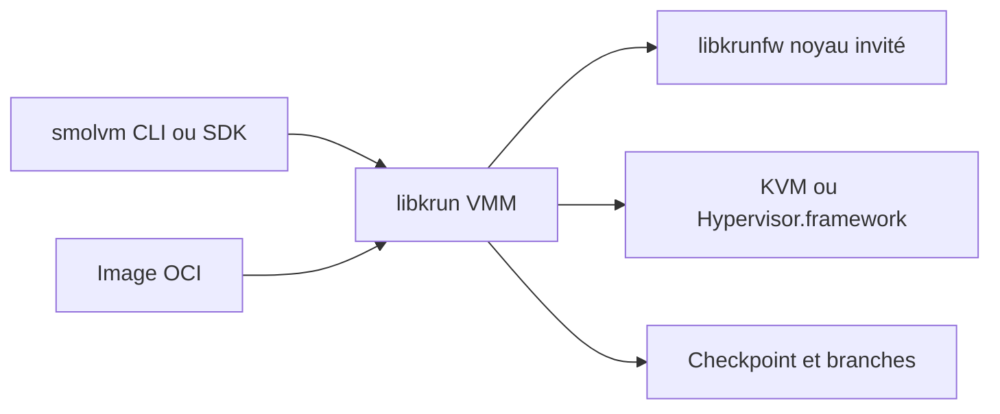

# smol-machines/smolvm

> Micro-machines virtuelles locales, embarquables et branchables, pour isoler des charges de travail d'agents d'IA.

## Le problème
Un conteneur partage le noyau de l'hôte, et une VM classique démarre lentement : mal commode pour exécuter du code généré par un agent.

## Ce que ça fait vraiment
Chaque charge tourne dans une VM matérielle avec son propre noyau (libkrun, sur KVM, Hypervisor.framework ou Windows Hypervisor Platform). Toute image OCI démarre sans démon Docker, en moins d'une seconde. Le réseau est coupé par défaut et peut être limité à des hôtes nommés ; un secret peut être utilisé sans que la charge le lise. On peut sauvegarder une machine en cours d'exécution, la brancher en copies, ou l'empaqueter en fichier `.smolmachine`. SDK Node, Python, Rust et Go.

## Comment c'est branché
Schéma simplifié d'après la fiche, sans diagramme fourni.


## Essayer
```bash
curl -sSL https://smolmachines.com/install.sh | bash
smolvm machine run --net --image alpine -- uname -a
smolvm machine create --net --name dev && smolvm machine start --name dev
smolvm machine start --name agent --branchable
smolvm machine checkpoint --name agent -o agent.checkpoint
```

## Coût et pièges
Gratuit en local. Valeurs par défaut : 4 vCPU et 8 Gio de RAM. Il faut KVM sous Linux ; pas de build publié pour macOS Intel. Chaque dossier monté ou secret transmis reste à ta charge.

## Ce que ce n'est pas
Pas un remplaçant de Docker pour l'orchestration. Le cloud « smol cloud » est mentionné comme option distincte. Le GPU reste indisponible sous Windows.

## Alternatives
- Containers, Colima, QEMU, Firecracker, Kata : comparés dans le README, sans SDK embarquable ni artefact portable.

## Pour toi
À adopter pour tester : une isolation par VM rapide pour exécuter du code d'agent en local, avec des garde-fous réseau explicites.

