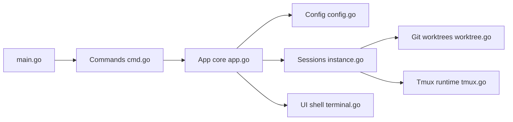

# smtg-ai/claude-squad

> Go TUI that runs several coding agents in parallel, each in its own git worktree.

## The problem
Running several Claude Code, Codex or Aider instances on the same repository causes file conflicts and a juggling act between terminals.

## What it actually does
`cs` creates a tmux session and a git worktree on its own branch for each task. The interface lists the sessions, shows a preview and diff, lets you attach to rerun a prompt, commit and push, and pause or resume. Profiles can be configured in `~/.claude-squad/config.json` to choose the program (claude by default, codex, gemini, aider). Experimental `--autoyes` mode.

## How it is wired


## Trying it
```bash
brew install claude-squad
ln -s "$(brew --prefix)/bin/claude-squad" "$(brew --prefix)/bin/cs"
curl -fsSL https://raw.githubusercontent.com/smtg-ai/claude-squad/main/install.sh | bash
cs
cs -p "codex"
```

## Cost and gotchas
Free tool; tmux and gh are required. The cost comes from the agents you launch (subscriptions or API keys), multiplied by the number of sessions.

## What it is not
Not an agent itself: a coordinator around tmux and git. AGPL-3.0 license, which makes no difference for local use but is restrictive if you redistribute a modified version.

## Alternatives
No named alternative; Aider, Codex and Gemini are agents it can drive, not alternatives.

## For you
Worth adopting if you already use coding agents: worktree isolation cleanly solves the conflicts and lets you run several tasks in the background, with a diff review before pushing.
