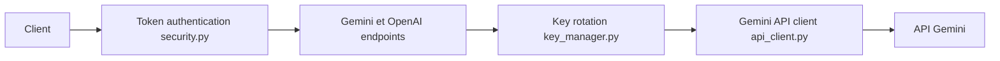

# snailyp/gemini-balance

> FastAPI proxy that spreads load across several Gemini API keys and also imitates the OpenAI API.

## The problem
The quotas of a single Gemini key are quickly exhausted, and OpenAI clients cannot talk to Gemini.

## What it actually does
Rotates several keys (`API_KEYS`) with retries and deactivation after too many failures, exposes the Gemini and OpenAI formats (chat, embeddings, images), offers web search, image editing, logs and a key status page. Configuration can be changed live from the admin.

## How it is wired


## Trying it
```bash
docker pull ghcr.io/snailyp/gemini-balance:latest
docker run -d -p 8000:8000 --name gemini-balance -v ./data:/app/data --env-file .env ghcr.io/snailyp/gemini-balance:latest
```

## Cost and gotchas
Gemini keys are at your expense; MySQL or SQLite database. The README declares CC BY-NC 4.0: no commercial use. Pooling keys may violate Google's terms (to be checked). Last push in September 2025.

## What it is not
Not an access reseller: the author states they sell nothing. Not meant to get around a free quota without accepting its conditions.

## Alternatives
No alternative named in the README.

## For you
Ignore: non-commercial license, single maintainer and dubious use of keys; prefer a real LLM gateway under a permissive license.
