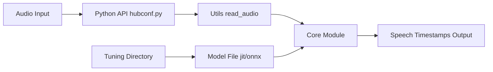

# snakers4/silero-vad

> Pre-trained, lightweight voice activity detector in PyTorch/ONNX, running on CPU.

## The problem
Splitting audio into speech segments (before transcription, voice bots, data cleaning) requires a reliable and fast VAD.

## What it actually does
`get_speech_timestamps` returns the speech segments of an audio file (in samples or seconds).
JIT model ~2 MB, under 1 ms per 30 ms chunk on a single CPU thread, 8 and 16 kHz.
Trained on corpora covering more than 6000 languages; PyTorch and ONNX versions.
Community examples in C++, Rust, Go, Java, C#, browser (ONNX Runtime Web); threshold tuning scripts.

## How it is wired


## Trying it
```bash
pip install silero-vad
```

## Cost and gotchas
Free, MIT, no telemetry or key. Requires an audio backend for torchaudio (FFmpeg, sox or soundfile). With ONNX alone, I/O must be reimplemented.

## What it is not
Not a transcription (STT) or diarization model: it only tells you where there is speech.

## Alternatives
None named in the README (points to Silero STT models).

## For you
To adopt: a standard building block in front of Whisper or any audio pipeline, free and fast on CPU, which reduces transcription cost.
