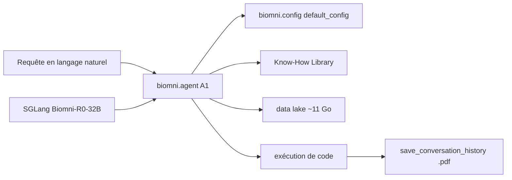

# snap-stanford/Biomni

> General-purpose biomedical agent that carries out research tasks through reasoning and code.

## The problem
A biomedical research task chains literature search, planning and analysis code.
Each step is done by hand, in tools with no continuity.

## What it actually does
An `A1` agent driven in natural language: `agent.go("Plan a CRISPR screen…")`, planning and code execution.
A Know-How Library of protocols and best practices, retrieved automatically according to the request.
Biomni-R0, a reasoning model built on Qwen-32B trained with reinforcement learning, served via SGLang.
Biomni-Eval1: 433 instances across 10 biological reasoning tasks, with a Python evaluator.

## How it is wired


## Trying it
```bash
conda activate biomni_e1
pip install biomni --upgrade
```

## Cost and gotchas
The data lake downloads itself on first launch: about 11 GB, can be disabled via `expected_data_lake_files=[]`.
Anthropic or other API key at your expense; the conda environment is described as massive, with known conflicts.

## What it is not
Not safe by default: the agent runs generated code with full system privileges, to be isolated before any serious use.
Not synchronized with the web platform: the published version is frozen at April 15, 2025.
Apache 2.0 on the Biomni side, but some integrated tools and databases carry restrictive commercial licenses.

## Alternatives
No alternative named in the README.

## For you
A good case study of a tooled scientific agent; only run it in a disposable container.
