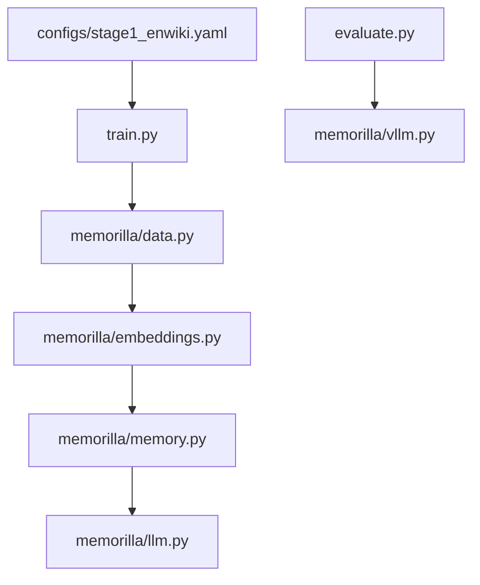

# snap-stanford/memorilla

> Research code that compresses a collection of documents into 16 memory tokens for a frozen LLM.

## The problem
An LLM only reads what fits in its context, and putting all the documents in slows its answers down considerably.

## What it actually does
- A memory module reads the whole collection and produces 16 question-dependent tokens.
- Claims better average results than Mem0 and MemoRAG, and on FactKG 84.33% versus 80.43% with all the documents, for 108 times fewer tokens.
- Three-stage training, evaluation on eight benchmarks, the PersonalizationV4 dataset and reinforcement learning on TextWorld.
- Checkpoints available on Hugging Face (Qwen3-8B).

## How it is wired


## Trying it
```bash
uv venv --python 3.11 && source .venv/bin/activate
uv pip install -e .
uv pip install --no-build-isolation flash-attn==2.7.4.post1
scripts/train.sh configs/stage1_enwiki.yaml
```

## Cost and gotchas
Linux, CUDA and Python 3.11; an 80 GB GPU is enough for the example (about 25 GB of models). Full training takes about 19 hours on 4 H100s and 310 GiB of data.

## What it is not
Not a product: a research repository tied to a paper. The figures come from the authors.

## Alternatives
- Mem0 and MemoRAG: memory methods the README compares itself to.

## For you
Worth watching: an interesting latent-memory approach for your agent research, but heavy on GPU and still at the research stage.
