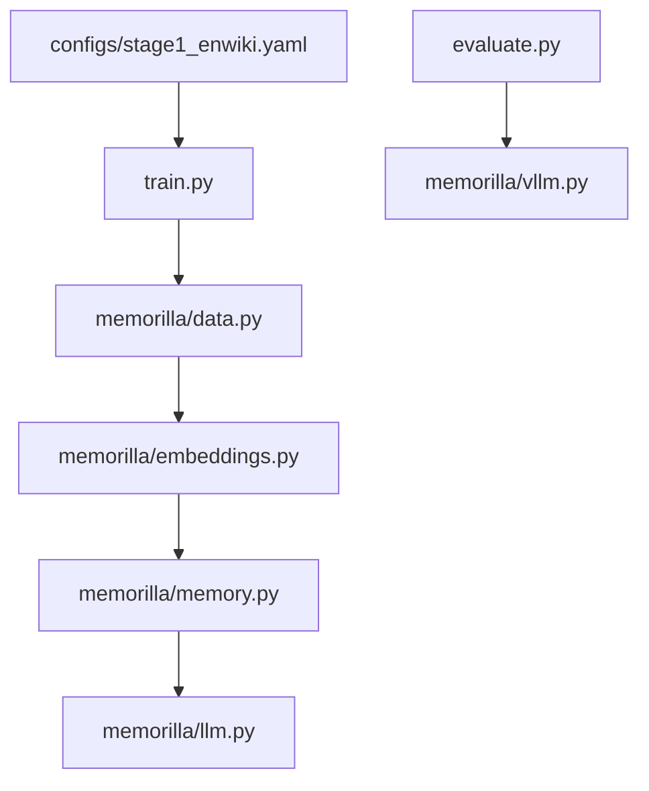

# snap-stanford/memorilla

> Code de recherche qui compresse une collection de documents en 16 jetons de mémoire pour un LLM gelé.

## Le problème
Un LLM ne lit que ce qui tient dans son contexte, et y mettre tous les documents ralentit fortement les réponses.

## Ce que ça fait vraiment
- Un module de mémoire lit toute la collection et produit 16 jetons dépendants de la question.
- Annonce de meilleurs résultats moyens que Mem0 et MemoRAG, et sur FactKG 84,33 % contre 80,43 % avec tous les documents, pour 108 fois moins de jetons.
- Entraînement en trois étapes, évaluation sur huit benchmarks, jeu PersonalizationV4 et apprentissage par renforcement sur TextWorld.
- Points de contrôle disponibles sur Hugging Face (Qwen3-8B).

## Comment c'est branché


## Essayer
```bash
uv venv --python 3.11 && source .venv/bin/activate
uv pip install -e .
uv pip install --no-build-isolation flash-attn==2.7.4.post1
scripts/train.sh configs/stage1_enwiki.yaml
```

## Coût et pièges
Linux, CUDA et Python 3.11 ; un GPU de 80 Go suffit pour l'exemple (environ 25 Go de modèles). L'entraînement complet prend environ 19 heures sur 4 H100 et 310 Gio de données.

## Ce que ce n'est pas
Pas un produit : un dépôt de recherche lié à un article. Les chiffres viennent des auteurs.

## Alternatives
- Mem0 et MemoRAG : méthodes de mémoire auxquelles le README se compare.

## Pour toi
À surveiller : approche de mémoire latente intéressante pour tes recherches sur les agents, mais lourde en GPU et encore au stade recherche.

