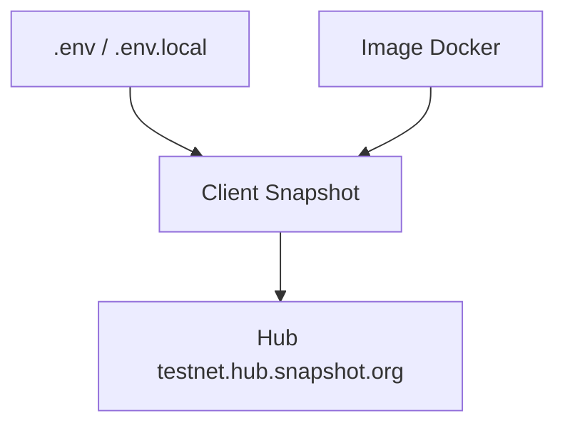

# snapshot-labs/snapshot-v1

> Web client for off-chain decentralized governance, with no gas fees, for verifiable votes.

## The problem
Voting in a decentralized organization through the chain costs fees on every vote. This client lets you vote off-chain.

## What it actually does
The README is very short: it is a web client (Vue interface, judging from the yarn commands) that connects to a "hub" to display and manage governance votes. In development it points by default to the test hub `testnet.hub.snapshot.org`. The internal workings are not documented.

## How it is wired
Simplified diagram based on the sheet, no diagram provided.



## Trying it
```bash
yarn
yarn dev
# puis http://localhost:8080/#/fabien.eth
docker build -t snapshot .
docker run --name snapshot -p 8080:8080 snapshot
```

## Cost and gotchas
Free. You need Node and yarn for development. The default hub is a testnet: for anything else you must override the values in `.env.local`.

## What it is not
It is not the protocol or the hub: only the client. The repo is called "v1", so an older version of the product. The README says nothing about security or architecture.

## Alternatives
No alternative named in the README.

## For you
Ignore: it is a blockchain governance client unrelated to data or MLOps, and the README is too thin to judge further.
