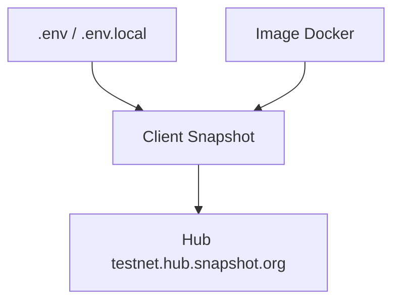

# snapshot-labs/snapshot-v1

> Client web de gouvernance décentralisée hors chaîne, sans frais de gas, pour des votes vérifiables.

## Le problème
Voter dans une organisation décentralisée en passant par la chaîne coûte des frais à chaque vote. Ce client permet de voter hors chaîne.

## Ce que ça fait vraiment
Le README est très court : c'est un client web (interface Vue, d'après les commandes yarn) qui se connecte à un « hub » pour afficher et gérer des votes de gouvernance. En développement il pointe par défaut sur le hub de test `testnet.hub.snapshot.org`. Le fonctionnement interne n'est pas documenté.

## Comment c'est branché
Schéma simplifié d'après la fiche, sans diagramme fourni.



## Essayer
```bash
yarn
yarn dev
# puis http://localhost:8080/#/fabien.eth
docker build -t snapshot .
docker run --name snapshot -p 8080:8080 snapshot
```

## Coût et pièges
Gratuit. Il faut Node et yarn pour le développement. Le hub par défaut est un testnet : pour autre chose il faut surcharger les valeurs dans `.env.local`.

## Ce que ce n'est pas
Ce n'est pas le protocole ni le hub : seulement le client. Le dépôt s'appelle « v1 », donc une version ancienne du produit. Le README ne dit rien de la sécurité ni de l'architecture.

## Alternatives
Aucune alternative nommée dans le README.

## Pour toi
À ignorer : c'est un client de gouvernance blockchain sans lien avec la data ou le MLOps, et le README est trop mince pour juger plus.

