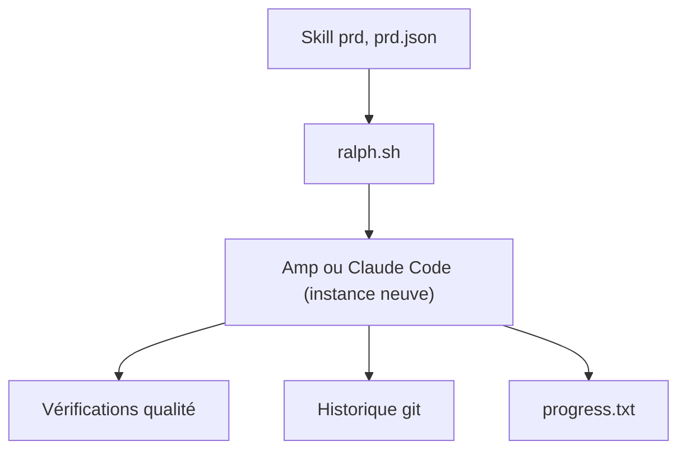

# snarktank/ralph

> Shell loop that relaunches Amp or Claude Code, with a fresh context, until all items of a PRD are done.

## The problem
A single coding agent saturates its context on a large feature and produces mediocre code.

## What it actually does
`ralph.sh` launches a fresh instance of the tool at each iteration: it takes the highest-priority unfinished story from `prd.json`, implements it, runs typecheck and tests, commits, marks `passes: true`, and appends lessons to `progress.txt`. Memory = git, `progress.txt`, `prd.json`. Provides two skills (`/prd`, `/ralph`).

## How it is wired


## Trying it
```bash
./scripts/ralph/ralph.sh [max_iterations]
./scripts/ralph/ralph.sh --tool claude [max_iterations]
/plugin marketplace add snarktank/ralph
cat prd.json | jq '.userStories[] | {id, title, passes}'
```

## Cost and gotchas
Each iteration consumes tokens from the chosen tool. Requires `jq`, a git repository, and reliable tests and typecheck.

## What it is not
Not an autonomous agent without guardrails: without a feedback loop (green CI), faulty code accumulates. Stories must be sliced small.

## Alternatives
Geoffrey Huntley's pattern, from which this repository derives.

## For you
Keep an eye on it: simple, transferable method to make coding agents more reliable, but a young repository maintained by one person.
