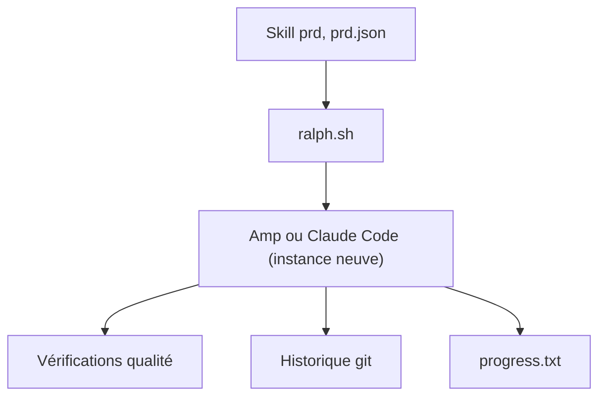

# snarktank/ralph

> Boucle shell qui relance Amp ou Claude Code, à contexte neuf, jusqu'à terminer tous les items d'un PRD.

## Le problème
Un agent de code seul sature son contexte sur une grosse fonctionnalité et produit du code médiocre.

## Ce que ça fait vraiment
`ralph.sh` lance une instance neuve de l'outil à chaque itération : elle prend la story prioritaire non terminée de `prd.json`, l'implémente, lance typecheck et tests, commite, marque `passes: true`, ajoute les leçons à `progress.txt`. Mémoire = git, `progress.txt`, `prd.json`. Fournit deux skills (`/prd`, `/ralph`).

## Comment c'est branché


## Essayer
```bash
./scripts/ralph/ralph.sh [max_iterations]
./scripts/ralph/ralph.sh --tool claude [max_iterations]
/plugin marketplace add snarktank/ralph
cat prd.json | jq '.userStories[] | {id, title, passes}'
```

## Coût et pièges
Chaque itération consomme des jetons de l'outil choisi. Requiert `jq`, un dépôt git, des tests et typecheck fiables.

## Ce que ce n'est pas
Pas un agent autonome sans garde-fou : sans boucle de retour (CI verte), le code défaillant se cumule. Stories à découper petit.

## Alternatives
Pattern de Geoffrey Huntley, dont ce dépôt dérive.

## Pour toi
Surveiller : méthode simple et transposable pour fiabiliser des agents de code, mais dépôt jeune et d'une seule personne.

