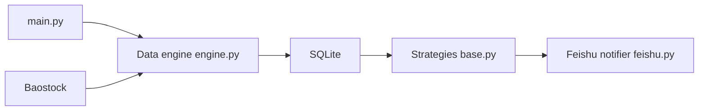

# sngyai/Sequoia-X

> Chinese A-share stock selection system: baostock data, quantitative strategies, Feishu notifications.

## The problem
Spotting each evening, among ~5,200 stocks, those that meet technical criteria.

## What it actually does
Fetches daily prices (baostock, into SQLite), runs six strategies listed in the README (TurtleTrade, MaVolume, HighTightFlag, LimitUpShakeout, UptrendLimitDown, RpsBreakout) and sends non-empty selections to a Feishu webhook. Initial backfill mode takes about 12 minutes, daily mode 2 to 3 minutes.

## How it is wired


## Trying it
```bash
uv sync
cp .env.example .env
python main.py --backfill
python main.py
```

## Cost and gotchas
Free; a Feishu webhook is required. No license: reuse rights uncertain. The diagram mentions Akshare and a PrivatePlacement strategy absent from the README.

## What it is not
Not financial advice nor a documented backtest engine.

## Alternatives
No alternative named in the README.

## For you
Ignore: A-share market only, no license, no announced validation of the strategies.
