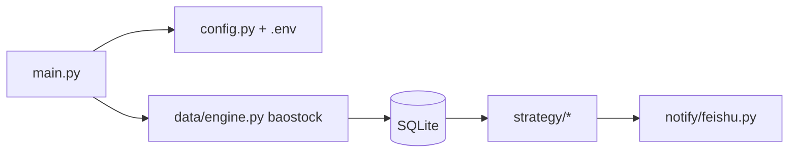

# sngyai/Sequoia

> Stock selection system for the Chinese A-share market, with strategies and Feishu notification.

## The problem
Filtering the roughly 5,200 A-shares every day according to technical strategies without doing it by hand.

## What it actually does
Sequoia-X V2 fetches adjusted daily prices from baostock, stores them in a local SQLite, runs six strategies (TurtleTrade, MaVolume, HighTightFlag, LimitUpShakeout, UptrendLimitDown, RpsBreakout) and pushes the result to a Feishu group. Two modes: daily (8 processes, 2 to 3 minutes) and historical backfill (about 12 minutes). The provided diagram describes the old version (AKShare, WxPusher) and no longer matches the README.

## How it is wired


## Trying it
```bash
uv sync
cp .env.example .env
python main.py --backfill
python main.py
```

## Cost and gotchas
Free; Feishu webhook to fill in `.env`. No license declared: use and redistribution not explicitly authorized.

## What it is not
Not investment advice nor a documented backtest: no performance result is presented. Market limited to China.

## Alternatives
No alternative named in the README.

## For you
Ignore: niche tool on a single market, without a license and without evaluation of its strategies.
